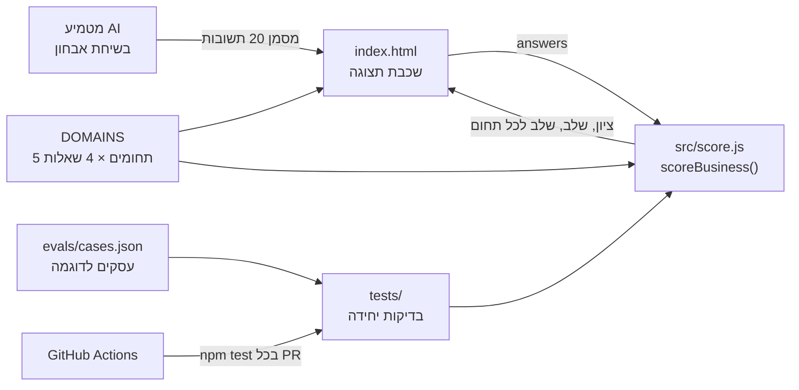
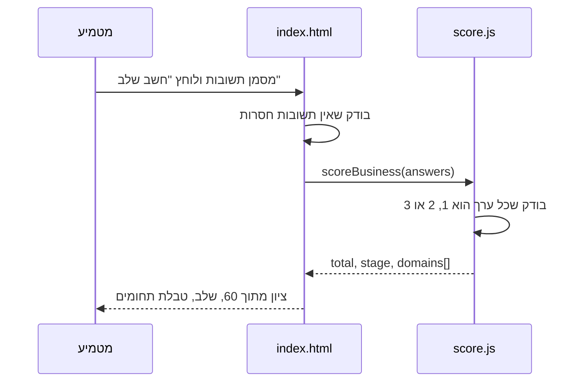

# ארכיטקטורה

המסמך הזה משלים את [מסמך האפיון](01-design.md). האפיון מגדיר מה בונים, והארכיטקטורה מגדירה ממה המערכת בנויה, איך החלקים מדברים זה עם זה, ולמה בחרנו כך.

## תמונה כללית

כל המערכת רצה בדפדפן של המטמיע. אין שרת, אין מסד נתונים, והתשובות לא יוצאות מהמחשב.



## רכיבים

| רכיב | קובץ | אחריות | לא אחראי על |
|---|---|---|---|
| תצוגה | `index.html` | בונה את הטופס מתוך `DOMAINS`, אוסף תשובות, מציג תוצאה | חישוב |
| הגדרת השאלון | `DOMAINS` ב-`src/score.js` | חמשת התחומים והשאלות בכל אחד | איך הם מוצגים |
| לוגיקת ציון | `scoreBusiness()` ב-`src/score.js` | בדיקת קלט, סכום, ממוצע, קביעת שלב | DOM, שמירה |
| גבולות השלבים | `stageForTotal()`, `stageForAverage()` | 20-33 / 34-46 / 47-60, ו-1.6 / 2.3 לכל תחום | - |
| בדיקות | `tests/score.test.js` | מקרי גבול וקלט שגוי | - |
| Evals | `evals/cases.json`, `tests/evals.test.js` | האם עסקים לדוגמה מסווגים לשלב הנכון | - |
| בקרה אוטומטית | `.github/workflows/test.yml` | מריץ `npm test` בכל Pull Request ובכל דחיפה ל-`main` | - |

## זרימת מידע



## מבנה הנתונים

קלט:

```js
{ strategy: [1, 2, 2, 1], management: [...], systems: [...], people: [...], finance: [...] }
```

פלט:

```js
{ total: 42, max: 60, stage: 'builder',
  domains: [{ id: 'strategy', name: 'אסטרטגיה ויעדים', sum: 6, average: 1.5, stage: 'firefighter' }, ...] }
```

## החלטות ארכיטקטורה (ADR)

### ADR-1: בלי שרת ובלי מסד נתונים

**החלטה:** הכול רץ בדפדפן.
**למה:** האבחון מכיל מידע רגיש על העסק. כשאין שרת, אין מה לאבטח ואין מידע שדולף. גם אין עלות תחזוקה.
**המחיר:** אי אפשר לשמור אבחונים קודמים או להשוות בין עסקים. זה מחוץ לתחום (ראו "מה לא נכלל" באפיון).

### ADR-2: הלוגיקה מופרדת מהתצוגה

**החלטה:** `score.js` לא נוגע ב-DOM, ו-`index.html` לא מחשב כלום.
**למה:** אפשר לבדוק את הלוגיקה ב-Node בלי דפדפן, ואפשר להחליף את התצוגה (למשל לבוט וואטסאפ) בלי לגעת בחישוב.

### ADR-3: השאלון מוגדר כנתונים

**החלטה:** התחומים והשאלות נמצאים במבנה `DOMAINS`, והטופס נבנה ממנו.
**למה:** שינוי שאלה או הוספת תחום הוא שינוי במקום אחד, והחישוב והתצוגה מתעדכנים יחד.

### ADR-4: JavaScript נקי, בלי framework ובלי build

**החלטה:** ES modules רגילים, בלי React, בלי npm dependencies.
**למה:** פרויקט קטן. אותו קובץ רץ בדפדפן וב-Node, ואין מה לעדכן או לשבור.

### ADR-5: Evals כקובץ נתונים נפרד מהבדיקות

**החלטה:** עסקים לדוגמה עם השלב הצפוי נמצאים ב-`evals/cases.json`.
**למה:** בדיקות יחידה בודקות שהקוד עושה מה שכתבנו. Evals בודקים שהתוצאה נכונה עסקית. מי שמכיר את התחום יכול להוסיף מקרה בלי לכתוב קוד.

## מה ישתנה בשלב ה-Deployment

- העלאה ל-GitHub Pages, כדי שהדף ייפתח מקישור (מקובץ מקומי הדפדפן חוסם את ה-module)
- הבדיקה האוטומטית תהיה תנאי להעלאה: אם `npm test` נכשל, לא מעלים
